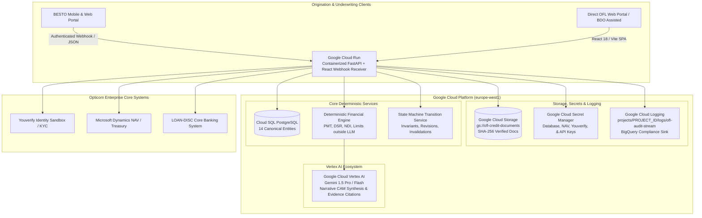

# Opticom Finance House (OFL) Credit Platform
## Google Cloud Platform (GCP) Deployment & Architecture Guide
**Client**: Opticom Finance House (RC: 347832)  
**Implementation**: CyberCapSec Limited  
**Target Environment**: Google Cloud Platform (GCP)  
**Region Baseline**: `europe-west1` (or `us-central1`)  
**Baseline**: PRD Version 1.1 / Roadmap v1.2  

---

## 1. Architectural Overview on Google Cloud Platform

The OFL Credit Automation & Underwriting Platform is deployed on **Google Cloud Platform (GCP)** to provide a scalable, highly secure, and tamper-evident credit origination engine for both BESTO (₦300k - ₦2m) and OFL Direct (> ₦2m) loan facilities.



---

## 2. Core GCP Services & Functional Mapping

| GCP Service | Role in OFL Platform | Configuration & Security Controls |
| :--- | :--- | :--- |
| **Google Cloud Run** | Serverless microservice host for FastAPI backend and static React portal. | Autoscales 1 to 10 instances; 1 vCPU, 1GiB RAM; HTTPS-enforced; runs under dedicated service account `ofl-app-runner`. |
| **Google Cloud Vertex AI (Gemini)** | Automated AI Underwriter drafting Credit Appraisal Memorandums (CAM). | Models: `gemini-1.5-pro` / `gemini-1.5-flash`; temperature `0.1`; deterministic metrics enforced outside LLM; token caps & cost tracking (FR-28, FR-29). |
| **Google Cloud Storage (GCS)** | Private document repository for KYC IDs, bank statements, audited financials, and signed offers. | Bucket: `gs://ofl-credit-documents`; Uniform Bucket-Level Access; Object Versioning; SHA-256 verification; time-limited v4 signed URLs. |
| **Google Cloud Secret Manager** | Secure key vault for API credentials, database strings, and third-party tokens. | Encrypted at rest with Google CMEK; access audited via IAM `roles/secretmanager.secretAccessor`; zero plain-text secrets in git. |
| **Google Cloud Logging** | Immutable, structured audit log stream and platform observability. | Stream: `projects/{project_id}/logs/ofl-audit-stream`; structured JSON payloads with correlation IDs; automated export sink to BigQuery. |
| **Google Cloud SQL** | ACID relational database hosting the 14 canonical credit entities. | Managed PostgreSQL 16; Private IP VPC peering; automated point-in-time recovery (PITR); zero-setup SQLite fallback for local testing. |
| **Google Artifact Registry** | Container registry for versioned Docker images. | Repository: `europe-west1-docker.pkg.dev/$PROJECT_ID/ofl-containers/ofl-platform`. |
| **Google Cloud Build** | Automated CI/CD pipeline executing pytest and pushing container revisions. | Triggered on git push; executes pytest with 100% pass threshold before building Docker image. |

---

## 3. Vertex AI & Gemini AI Underwriter Architecture

### 3.1 Strict Human-Controlled Governance (PRD FR-06, FR-28)
1. **AI Does Not Decide**: Gemini acts as a draft appraisal memorandum assistant. It does not issue approvals, declines, or disbursement authorizations.
2. **Deterministic Financial Math**: 
   - All financial numbers (Monthly Installment `PMT`, Debt Service Ratio `DSR`, Net Disposable Income `NDI`, Max Capacity, Collateral Coverage) are computed by `FinancialEngine.evaluate()` in pure deterministic Python.
   - The LLM is fed pre-calculated, immutable numbers and is forbidden from performing arithmetic.
3. **Documentary Evidence Citations**:
   - The AI CAM references ingested documents by filename, document type, and cryptographic SHA-256 hash.
4. **Token Telemetry & Cost Capping (FR-29)**:
   - Every CAM draft records prompt tokens, candidate tokens, total tokens, and USD/NGN costs.
   - Monthly Opticom budget ceiling ($150.00/month) is tracked in real-time in the `AuditTelemetry` dashboard.

---

## 4. Google Cloud Storage (GCS) Document Repository

### 4.1 Document Pathing Topology
All documents are stored within Google Cloud Storage using an immutable case directory structure:
```
gs://ofl-credit-documents/
└── cases/
    └── {case_id}/
        ├── KYC_ID/
        │   └── national_identity_nin.pdf
        ├── BANK_STATEMENT/
        │   └── 6_month_turnover_statement.pdf
        ├── FINANCIAL_STATEMENT/
        │   └── audited_accounts_2025.pdf
        └── OFFER_LETTER/
            └── executed_binding_offer.pdf
```

### 4.2 Cryptographic Integrity & Private Access
- **SHA-256 Hash**: Computed before upload and stored in the database. Any discrepancy invalidates document verification.
- **Signed URLs**: Documents are never public. Credit officers and auditors access documents through 60-minute time-limited Google Cloud Storage v4 signed URLs.
- **Local Dev Parity**: When running locally without active GCP credentials (`GCS_LOCAL_EMULATOR=true`), files are stored in `backend/storage/gcs_emulator/` while preserving identical SHA-256 calculations and API routes.

---

## 5. Google Cloud Secret Manager

### 5.1 Secret Inventory
The platform integrates with GCP Secret Manager via `GCPSecretManagerService` (`secret_manager_service.py`):

| Secret Name | Purpose | Fallback / Mock Behavior |
| :--- | :--- | :--- |
| `DATABASE_URL` | Cloud SQL PostgreSQL connection URI | `sqlite:///./ofl.db` in local development |
| `GEMINI_API_KEY` | Optional Vertex AI / Gemini API key | Google Application Default Credentials (ADC) |
| `YOUVERIFY_API_KEY` | Real-time BVN/NIN verification sandbox key | Mock sandbox enabled if unconfigured (`MOCK_YOUVERIFY_SANDBOX=true`) |
| `NAV_INTEGRATION_KEY` | Microsoft Dynamics NAV Treasury secret | Mock NAV adapter enabled (`MOCK_NAV_INTEGRATION=true`) |
| `LOANDISC_API_TOKEN` | LOAN-DISC core banking synchronization token | Mock adapter enabled (`MOCK_LOANDISC_INTEGRATION=true`) |

---

## 6. Google Cloud Logging & Audit Trail

### 6.1 Structured JSON Schema
All state machine transitions, CAM drafting events, and approval decisions stream structured log entries to Google Cloud Logging:

```json
{
  "platform": "Opticom Credit Platform (GCP)",
  "environment": "production",
  "timestamp": "2026-10-27T15:45:00.000Z",
  "actor": "Oluwaseun Adeyemi",
  "role": "HRM",
  "event": "CASE_APPROVED",
  "entity": "CreditCase",
  "entity_id": "OFL-2026-00002",
  "reason": "Facility within HRM approval mandate (₦5,000,000 ceiling)",
  "correlation_id": "9b1deb4d-3b7d-4bad-9bdd-2b0d7b3dcb6d",
  "details": {
    "approved_amount": 4500000.0,
    "tenor": 12,
    "revision": 1
  }
}
```

---

## 7. Deployment Runbook

### 7.1 Provision GCP Infrastructure
Run the automated setup script with standard Google Cloud SDK permissions:
```bash
chmod +x deploy/gcp_setup.sh
export GCP_PROJECT_ID="your-opticom-gcp-project"
export GCP_REGION="europe-west1"
./deploy/gcp_setup.sh
```

### 7.2 Submit Automated Cloud Build & Deployment
Submit the build to Google Cloud Build:
```bash
gcloud builds submit --config cloudbuild.yaml .
```

### 7.3 Local Development with GCP Services
To run locally against real or simulated GCP services:
```bash
# 1. Authenticate with GCP Application Default Credentials
gcloud auth application-default login

# 2. Launch dual-server local environment
python run_dev.py
```
- Web Portal: [http://localhost:5173](http://localhost:5173)
- FastAPI Swagger Docs: [http://127.0.0.1:8000/docs](http://127.0.0.1:8000/docs)
- GCP Infrastructure Status: [http://127.0.0.1:8000/api/v1/telemetry/gcp-infrastructure](http://127.0.0.1:8000/api/v1/telemetry/gcp-infrastructure)

---

## 8. Enterprise Production Enhancements & Resilience Patterns

The enterprise deployment includes 6 core resilience patterns implemented for banking-grade reliability:

### 8.1 Enterprise IAM & Role-Based Access Control (RBAC)
- **Token Format**: Signed HS256 JWT Bearer tokens with 12-hour session lifespan.
- **SSO Federation**: Google Workspace / Microsoft Entra ID enterprise token exchange (`POST /api/v1/auth/sso-callback`).
- **Pre-provisioned Staff Roles**: `ANALYST`, `HRM`, `BCC`, `MD`, `TREASURY`, `IT_OWNER`.
- **Enforcement**: Dependency-injected `require_roles([Role...])` protecting sensitive credit approval and disbursement pathways.

### 8.2 Inbound Webhook HMAC SHA-256 Verification
- **Header**: `X-Signature-SHA256` computed over the raw request payload bytes using the enterprise secret key.
- **Verification**: Constant-time `hmac.compare_digest` to eliminate timing attack vectors. Unsigned/tampered requests in production return `401 Unauthorized`.

### 8.3 Scanned Statement OCR via Google Cloud Document AI
- **Trigger**: Heuristic text-density analyzer detecting photocopy / low-character statements (< 80 characters extracted).
- **Processing**: Fallback to Google Cloud Document AI / Vision API processing for optical character recognition and transaction table extraction.
- **Audit Tagging**: Analysis metadata tagged with `ocr_engine: GOOGLE_DOCUMENT_AI_FALLBACK`.

### 8.4 Asynchronous Background Job Tracker
- **Worker Architecture**: Decoupled asynchronous thread pool / Cloud Tasks compatibility.
- **Job Registry**: `JobManager` maintaining task states (`QUEUED`, `PROCESSING`, `COMPLETED`, `FAILED`) and live completion percentages.
- **Client Polling**: Non-blocking client polling via `GET /api/v1/jobs/{job_id}`.

### 8.5 Multi-Channel Transactional Notifications (SMS & Email)
- **SMS Gateway**: Termii Nigeria / Twilio transactional SMS for borrower OTPs, exception rework requests, and RTGS disbursement alerts.
- **Email Gateway**: SendGrid Enterprise / Google Workspace SMTP for formal credit sanction notices and offer letters.
- **Audit Logging**: Every dispatch logged and streamed to Google Cloud Logging (`GET /api/v1/telemetry/notifications`).

### 8.6 Schema Migrations via Alembic
- **Versioning**: Alembic environment tracking schema revisions for Cloud SQL PostgreSQL 16.
- **Execution**: Automated `alembic upgrade head` in Cloud Build CI/CD pipeline prior to traffic redirection.
